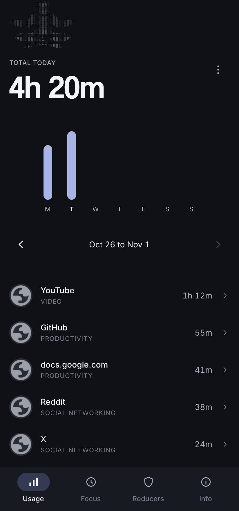
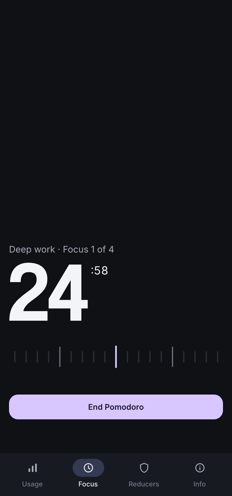
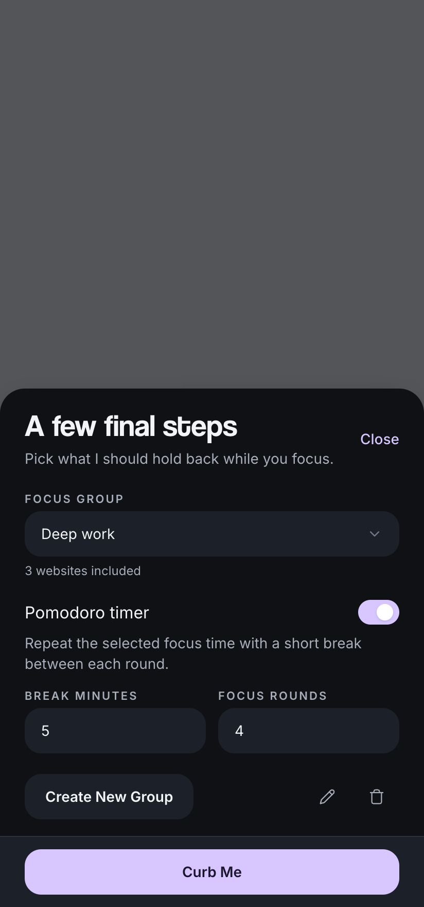
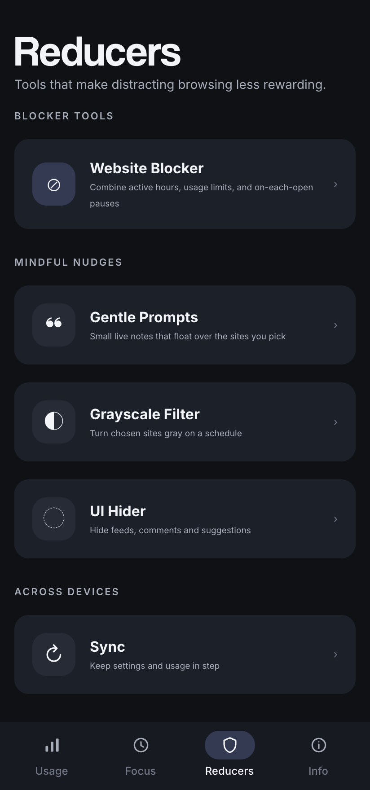
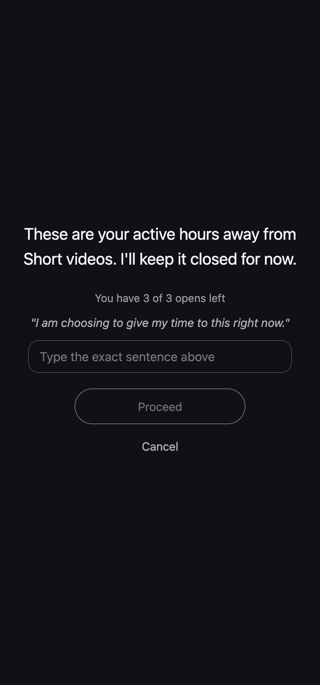

<div align="center">
  
  <h2>Curbox Browser</h2>

  [](https://github.com/curbox-app/curbox-extension/graphs/contributors)
  [](https://discord.com/invite/Vs9mwUtuCN)
  [](https://t.me/curboxapp)
  [](#chrome-brave-edge-helium-and-other-chromium-browsers)
  [](#firefox)

</div>

Curbox Browser is the open source browser companion to [Curbox for Android](https://github.com/curbox-app/curbox-android). It helps you reclaim your time online and master your browsing habits with the same tools as the app: honest usage stats, website and keyword blocking, focus sessions with a Pomodoro timer, and mindful nudges that make distracting sites less rewarding. When you hit a block, Curbox puts a calm warning screen in the way instead of a hard wall, so it feels like a pause and not a punishment.

### Screenshots

<div align="center">
<table>
	<tr>
		<td></td>
		<td></td>
		<td></td>
		<td></td>
		<td></td>
	</tr>
</table>
</div>

### Why Curbox Stands Out

Most screen time tools are closed source, which raises fair questions about whether your browsing history is being tracked or sold. Curbox takes a different path.

* **Open Source Transparency.** The entire codebase is public. Anyone can verify what the extension does, so there are no hidden trackers or surprise behaviors.
* **Your data stays on your device.** Usage, settings and focus history are kept in your browser's local extension storage. There are no analytics, no ads and no account. Nothing leaves your browser.
* **Honest numbers.** Time only counts while you are actually looking at a site: the tab is active, the window is focused, the page is visible and you are at your computer. A tab left open in the background never inflates your stats.
* **One habit system across devices.** Groups, unlock challenges, focus modes and wording mirror the Android app, so the rules you learn on your phone work the same way in your browser.

### Platforms

- Android: [curbox-app/curbox-android](https://github.com/curbox-app/curbox-android)
- Browser extension (this repository): Chrome, Brave, Edge, Helium and other Chromium browsers, plus Firefox
- iOS (coming soon)

### How to install

Curbox Browser is not on the browser stores yet, so for now you build and load it yourself. It takes about two minutes. You can also [read the docs](https://curbox.app/docs) for step by step instructions.

```bash
npm install            # install dependencies
npm run build          # Chromium build  ->  .output/chrome-mv3
npm run build:firefox  # Firefox build   ->  .output/firefox-mv2
```

#### Chrome, Brave, Edge, Helium and other Chromium browsers

1. Run `npm install` and then `npm run build`.
2. Open your extensions page (for example `chrome://extensions`).
3. Turn on **Developer mode**.
4. Click **Load unpacked** and choose the `.output/chrome-mv3` folder.

#### Firefox

1. Run `npm install` and then `npm run build:firefox`.
2. Open `about:debugging` and click **This Firefox**.
3. Click **Load Temporary Add-on** and choose any file inside `.output/firefox-mv2`.

> Firefox removes temporary add-ons when you restart the browser.

The first time you open Curbox it walks you through the same introduction as the Android app: a short look at why phones and feeds are built to be addictive, an estimate of how much time scrolling takes from your year, and a first target site with a daily limit.

### In-Depth Feature Analysis

Curbox goes beyond simple site timers. It targets the specific triggers that lead to mindless scrolling. Click the toolbar button to open the whole app in its own window (or a tab on mobile). Usage, Focus, Reducers and Info all live there.

#### Insights & Awareness
- **Usage Analytics:** Today's total in large type, a weekly bar graph you can scroll back through, and a four week view. Sites are listed by time spent with their category (Video, Social networking, Productivity and more).
- **Path Level Breakdown:** Open any site to see where the time went inside it, so `youtube.com` splits into the videos and the `/shorts` that quietly ate your afternoon.
- **Ignored Sites:** Leave sites out of your stats, just like ignored apps on Android.
- **CSV Export:** Export a daily breakdown, a total summary or both for any date range, in the same layout as the Android export.
- **Background Art:** Pick the ASCII art behind your usage stats from the same set as the Android app, or let Curbox choose one at random.
- **Private by Design:** Usage is stored one day at a time and kept for four weeks, then cleared automatically.

#### Blocking & Control
- **Website Blocker:** Put sites into groups and combine the same controls as the Android app:
  - **Active hours:** all day, one daily schedule, or different time ranges for each weekday, including ranges that run past midnight.
  - **Usage limits:** only browsing inside the active hours counts. A zero minute limit blocks the site for the whole window.
  - **On each open:** Curbox stops you once when you enter a group, then asks again after you leave and come back.
- **URL Path & Keyword Blocking:** Block a section of a site instead of the whole thing, so you can kill the feed and keep the tool.

  | Pattern | What it blocks |
  | --- | --- |
  | `youtube.com` | the whole site |
  | `youtube.com/shorts` | one section of a site |
  | `/reels` | that path on any site |
  | `*.reddit.com` | the site and its subdomains |
  | `youtube` | any site with that word in its domain |
  | `r:shorts\|reels` | a raw regular expression for advanced rules |

- **Imported Lists & Website Packs:** Import a plain word list or a hosts file, or add a ready made pack from the community [website packs](https://github.com/curbox-app/website_packs) (topics, mixed topics, ads and trackers). Packs can hold a hundred thousand domains and are compiled once, so matching stays fast.
- **Granular UI Hiding:** Hide the parts of a site built to keep you scrolling while keeping the rest. YouTube: home feed, video recommendations, comments, Shorts, live chat and the notification count. X: the For you tab, opening Following instead. Hidden parts never flash in because they are removed before the page paints.

#### Mindful Usage Tools
- **Focus Mode:** Pick a focus group and how long you want to focus on the big minute ruler (drag it, scroll it, or type the minutes). Block only the selected sites, or block everything except them. Choose whether you are allowed to quit mid session.
- **Pomodoro Timer:** Repeat the selected focus time with a short break between each round, exactly like Android: 2 to 12 rounds and breaks of up to 120 minutes. Sites unblock during breaks and every focus round is logged.
- **Focus Statistics:** Sessions, total focus time, average and longest session, completion rate, your current streak and a weekly chart, filterable by focus group.
- **Gentle Prompts:** A small live note that floats over the sites you choose, with its own text size, colors, opacity and position. Messages can use the same variables as Android: `{app_name}`, `{app_usage_today}`, `{app_usage_yesterday}`, `{app_opens_today}`, `{screentime_today}`, `{screentime_yesterday}`, `{mindful_apps_usage_today}`, `{live_session_duration}`, `{reel_count}`, `{group_usage_today:Name}` and `{group_usage_yesterday:Name}`.
- **Site Specific Grayscale:** Turn chosen sites gray on a schedule while everything else stays in color. Gray sites are gray from the first paint.

#### Unlock Mechanisms
Define what happens on the warning screen when you try to open a blocked site. The options, names and order match the Android app:
- **Never Unlock:** Total lockdown. No bypassing allowed.
- **Require effort to unlock:**
  - **Unlock requires typing a sentence:** type a sentence exactly to prove focus. Pasting is disabled.
  - **Unlock requires stating an intent:** briefly describe your goal, with a minimum number of characters.
  - **Adaptive math:** solve questions whose difficulty adapts from simple arithmetic (level 1) to decimals, fractions, roots and powers (level 10). A wrong answer makes you wait 15 seconds.
- **Wait to unlock:**
  - **Only give me a fixed amount of time:** the site locks again after a set duration.
  - **Ask me how much time I need:** choose the duration on each unlock.
- **Wait before unlocking:** a countdown before you can press Proceed, which forces you to think before bypassing the block.
- **Limit unlock frequency:** allow a number of proceeds per time window, shown as "You have 2 of 3 opens left".
- **Daily focus requirement:** unlocking is only allowed after a chosen amount of focus time is completed today.
- **Custom Warning Message:** write the message you see on the warning screen.

Videos and music behind the warning screen pause, and they cannot start again until you are through.

#### Sync
Encrypted sync is not connected in this build. Everything stays in this browser. The encryption and merge logic is already in place for a future sync service.

### Supported Browsers

| Browser | Build | Notes |
| --- | --- | --- |
| Chrome, Brave, Edge, Helium and other Chromium browsers | Manifest V3 | Full support |
| Firefox | Manifest V2 | Full support. Built to also run on Firefox for Android, where the app opens as a tab. |

#### Why Curbox asks for each permission

| Permission | Used for |
| --- | --- |
| `storage`, `unlimitedStorage` | Keeping your usage, settings and imported lists on your device |
| `tabs` | Knowing which site is active, so only time you actually spend gets counted |
| `alarms` | Saving usage regularly and ending focus sessions and unlocks on time |
| `idle` | Pausing the clock when you step away or lock your screen |
| `favicon` | Showing site icons in your usage list |
| `scripting` | Showing the warning screen on tabs that were open before Curbox was installed |
| Access to all sites | Showing the warning screen, gentle prompts, grayscale and UI hiding on the sites you choose |

### Development

```bash
npm run dev            # Chromium with hot reload
npm run dev:firefox    # Firefox with hot reload
npm run compile        # type check
npm test               # unit tests (vitest)
```

Built with [WXT](https://wxt.dev), [React](https://react.dev), [TypeScript](https://www.typescriptlang.org) and [Tailwind CSS](https://tailwindcss.com).

| Folder | What lives there |
| --- | --- |
| `src/entrypoints` | The background worker, the content script and the app pages |
| `src/core` | Usage tracking, blocking decisions, focus sessions and Pomodoro |
| `src/content` | Warning screen, gentle prompts, grayscale and UI hiding inside pages |
| `src/lib` | Storage, matching, settings and shared helpers |
| `src/ui` | The app interface |

### Contributing

We welcome contributions from the community! If you want to help improve Curbox, please follow these steps:

1. Fork the repository.
2. Create a new branch for your feature or bugfix.
3. Commit your changes with a clear message.
4. Push to your branch.
5. Create a new Pull Request.

Sites change their layouts often, so help with keeping the UI Hider rules working and finding new ways to hide distracting parts of the web is especially appreciated. Please don't open a PR if you "vibe code" and have no idea what the code does. In that case, just open an issue with the feature request.

Please read [CONTRIBUTING.md](CONTRIBUTING.md) before working on the project.

### Special Thanks

* All my beloved donors and sponsors
* Everyone who contributes to the [website packs](https://github.com/curbox-app/website_packs)
* [WXT](https://wxt.dev): for making cross browser extensions pleasant to build
* [node-qrcode](https://github.com/soldair/node-qrcode): for device pairing codes

### Contact

For questions or feedback, please open an issue on the GitHub repository or reach out:
* Discord: @nethical
* Telegram: @nethicalps
* Email: [aguptaq88@gmail.com](mailto:aguptaq88@gmail.com)

[Donate](https://curbox.app/donate) · [Android app](https://curbox.app/install-android) · [Instagram](https://instagram.com/curb.me)

### TAGS (ignore em pls)

<details>
<summary>Keywords</summary>

website blocker extension, free website blocker, open source website blocker, chrome website blocker, firefox website blocker, browser extension blocker, screen time extension, browser screen time tracker, website time tracker, digital wellbeing extension, focus extension, productivity extension, pomodoro extension, pomodoro timer chrome, focus timer extension, distraction blocker, social media blocker, YouTube Shorts blocker, YouTube recommendations blocker, hide YouTube home feed, hide YouTube comments, Instagram Reels blocker, Reddit blocker, Twitter blocker, X For You blocker, TikTok blocker, doomscrolling blocker, keyword blocker, URL blocker, grayscale extension, website usage tracker, website time limit, self control extension, deep work extension, study focus extension.

StayFree alternative, BlockSite alternative, LeechBlock alternative, Cold Turkey alternative, Freedom alternative, Forest extension alternative, RescueTime alternative, Unhook alternative, DF Tube alternative, News Feed Eradicator alternative, Opal alternative, one sec alternative, Intention alternative, Mindful Browsing alternative, StayFocusd alternative, free StayFree alternative, open source BlockSite alternative, no subscription website blocker, private website blocker, offline website blocker.

</details>
